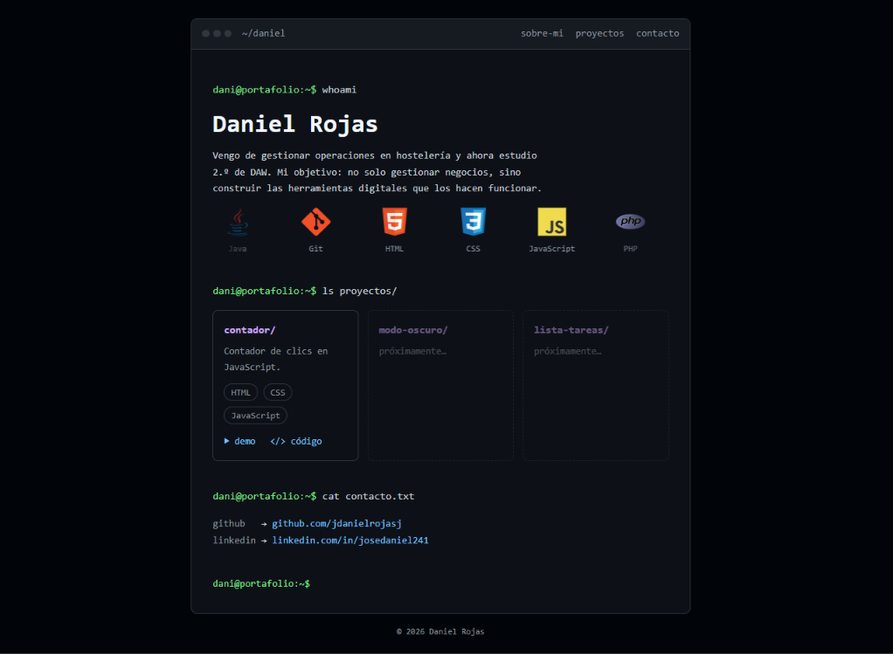

# Portafolio

Mi portafolio personal: una página con estilo de terminal donde me presento, enseño mis proyectos y dejo mis enlaces de contacto. Está hecho solo con HTML y CSS, sin frameworks.

## Demo

[Ver el portafolio](https://jdanielrojasj.github.io/)

## Tecnologías

- HTML
- CSS

## Qué he aprendido

- Estructurar una página con etiquetas semánticas (`header`, `nav`, `main`, `section`, `footer`) y enlazar cada sección del menú con anclas como `#contacto`.
- Guardar los colores y la tipografía en variables CSS para cambiarlos en un solo sitio.
- Colocar las tarjetas con Grid y alinear elementos con Flexbox: `justify-content` en el eje principal y `align-items` en el cruzado.
- Añadir el prompt de la terminal delante de cada título con `::before`, sin repetirlo en el HTML.
- Entender la especificidad y que, cuando dos reglas empatan, gana la que está más abajo en el archivo.
- Adaptar la página al móvil con `@media` y usar las herramientas de desarrollador para encontrar lo que se sale de la pantalla.
- Abrir los enlaces externos en otra pestaña con `target="_blank"` y protegerlos con `rel="noopener"`.
